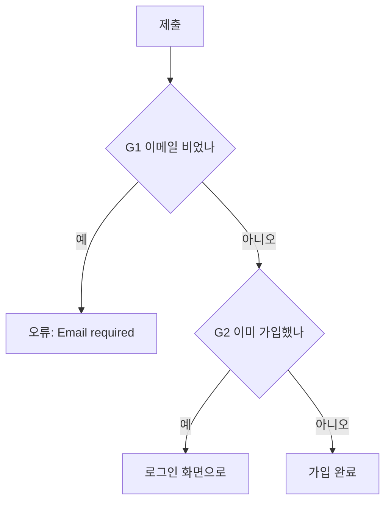

# 작업 흐름

작업은 **신규 기능** 과 **수정** 두 갈래다. 어느 쪽인지 애매하면 시작 전에 묻는다.

## 신규 기능

1. **plan 모드** — 코드 탐색, 모르는 건 질문, 설계를 사용자와 합의한다. plan 파일은 일회용 구현 순서다(저장소에 남기지 않는다).
2. **명세 작성** — 합의한 요구사항·결정·함정을 프로젝트가 정한 명세 위치(`.claude/docs-map.md` 참고, 보통 `<모듈 스킬>/features/<기능>.md`)에 쓴다. 오래 남는 기록은 이 명세 하나다. 명세에는 **로직 게이트**를 반드시 넣는다(아래 형식). 게이트는 plan 단계에서 사용자와 합의한 것이어야 한다 — 리뷰어는 코드가 게이트와 맞는지만 보고, 게이트 자체가 맞는지는 못 본다.
3. **개발** — `tdd` 스킬로 진행한다. 게이트의 테스트 칸이 곧 쓸 테스트 목록이다.
4. **검증·리뷰** — `review-loop` 스킬로 기계 검증(typecheck·lint·test) → `code-reviewer` 리뷰 → 수정을 반복한다.

### 로직 게이트 형식

기능의 분기를 mermaid 로 그리고, 분기마다 게이트 ID(G1, G2 …)를 붙인 뒤 표로 테스트와 짝짓는다.

````markdown


| 게이트 | 분기 | 테스트 |
|---|---|---|
| G1 | 빈 이메일 → 오류 | `빈 이메일은 거부한다` |
| G2 | 가입된 이메일 → 로그인 이동 | `가입된 이메일은 로그인으로 보낸다` |
````

## 수정 (버그·동작 변경)

1. **원인 확인** — 재현하고 근본 원인을 찾는다. 추측으로 고치지 않는다.
2. **실패 테스트** — 버그를 재현하는 테스트부터(`tdd`). 수정으로 분기가 바뀌면 그 기능 명세의 로직 게이트도 함께 고친다.
3. **수정** → 4. **검증·리뷰** (위와 같음. 게이트가 그대로면 버그 설명과 재현 테스트가 리뷰의 의도 근거다)

## 공통 원칙

- 실행 결과 없이 "완료·통과·고쳤다"고 말하지 않는다. 실패·건너뛴 단계도 그대로 보고한다.
- 코드 파일 수정은 Edit/Write 로 한다(sed·heredoc 금지) — 문서 점검 훅이 Edit/Write 기록으로 수정 파일을 추적한다.
